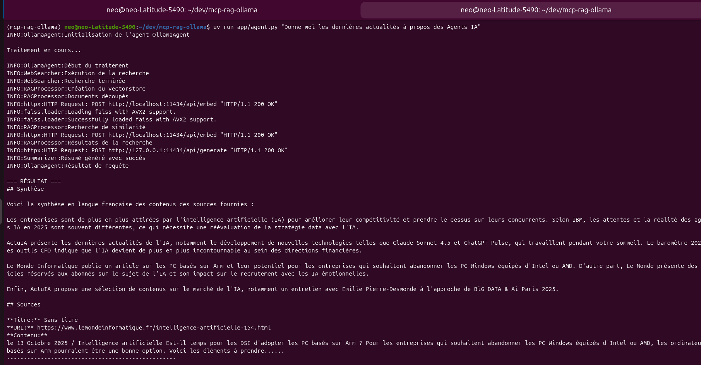
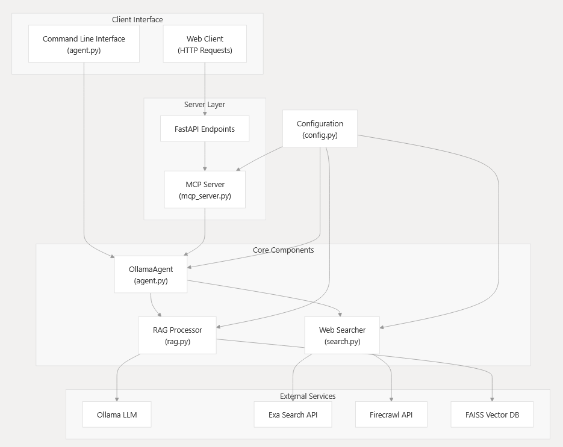
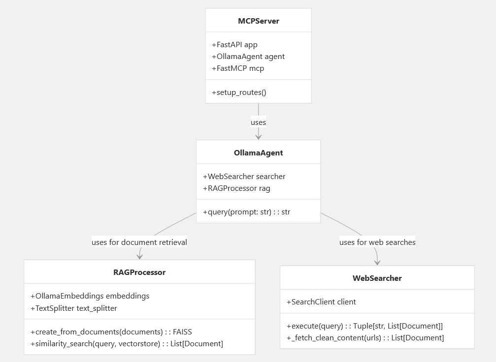
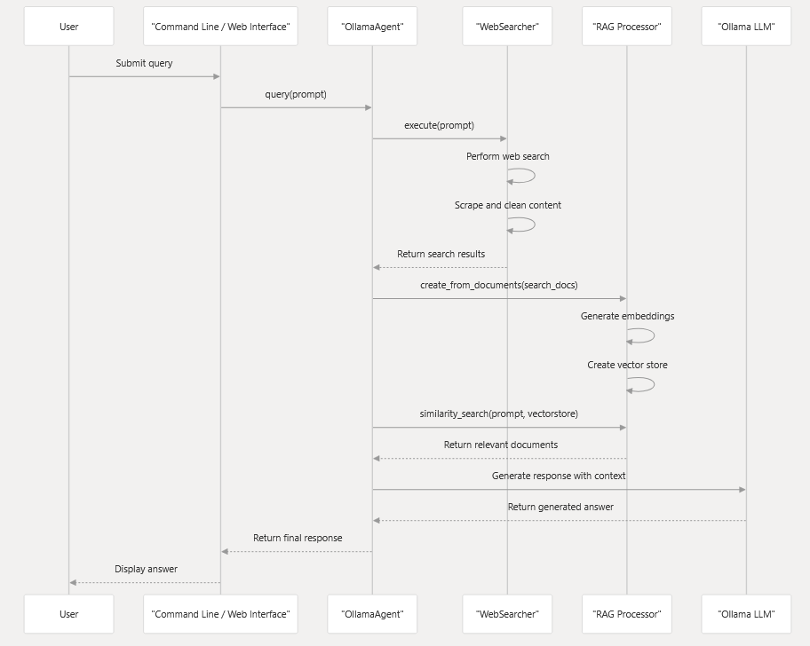
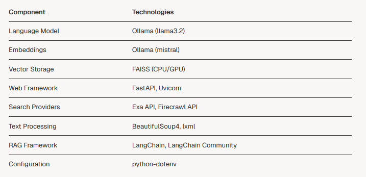
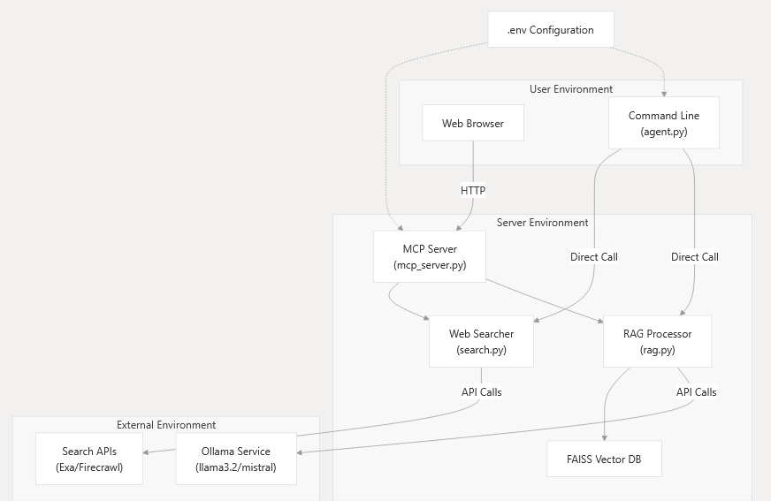

# MCP-RAG-AI-AGENT
## A MCP Rag AI Agent for Search 🔍,Analysis 📊 and Generative ✍️ tasks on listed web sources.

[](https://opensource.org/licenses/MIT)

Un agent conversationnel intelligent implémentant le protocole Model Context Protocol (MCP) avec capacités RAG (Retrieval-Augmented Generation) utilisant Ollama comme backend LLM.


## Présentation de l'application

Cette application est un agent conversationnel intelligent qui combine plusieurs technologies avancées :

1. **Conformité avec le Protocole MCP(Model Context Protocol )** : Le Model Context Protocol (MCP) est un cadre standardisé permettant de définir et de gérer le contexte des agents IA, garantissant une meilleure interopérabilité, traçabilité et explicabilité. Dans ce système multi-agents, le MCP permet d’uniformiser la communication entre agents en encapsulant leurs métadonnées, leurs capacités et leurs contraintes.

2. **Architecture RAG & Modeles LLM avec Ollama** : 
   - Utilisation de modèles LLM locaux via Ollama
   - Pipeline complet de traitement des documents (extraction, découpage, embedding)
   - Recherche vectorielle avec FAISS (CPU/GPU)

3. **Architecture multi-agents** :
   - Agent de recherche (combine recherche web et RAG)
   - Agent d'analyse (analyse sémantique et statistique)
   - Agent de génération (création de contenu)

4. **Fonctionnalités avancées** :
   - Logging structuré pour le débogage
   - Configuration centralisée
   - Support multi-fournisseurs de recherche (Exa, Firecrawl)
   - Gestion automatique des erreurs

L'application est particulièrement adaptée pour :
- Les assistants virtuels intelligents
- Les systèmes de recherche d'information augmentée
- Les outils d'analyse de contenu
- Les générateurs de contenu automatisés

Le système est conçu pour être extensible avec de nouveaux agents et capacités tout en maintenant une architecture propre et modulaire.

## Fonctionnalités clés

- 📚**Recherche augmentée** : Combinaison de recherche web et RAG pour des réponses précises
- 🤖 **Multi-agents** : Architecture modulaire avec agents spécialisés
- ✅**Protocole MCP** : Implémentation du standard de conversation machine-to-machine
- ✨**Intégration Ollama** : Utilisation des modèles LLM locaux via Ollama
- 📝**Traitement avancé** : Extraction, nettoyage et analyse de contenu web

## Architecture technique

```markdown
NEXUS-MCP-LLM-RAG/
│
├── app/
│   ├── agent.py                 # Main agents (research, analysis, generation)
│   ├── agent_orchestrator.py    # Agent coordination logic
│   ├── config.py                # Central configuration
│   ├── mcp_server.py            # FastAPI MCP implementation
│   ├── rag.py                   # RAG processing
│   ├── search.py                # Advanced web search
│   │
│   └── utils/
│       └── logging_service.py   # Structured logging service
│
├── pyproject.toml               # Project configuration
├── requirements.txt             # Python dependencies
└── .env.sample                  # Environment template
```

## Prérequis

- Python 3.10+
- Ollama installé localement avec au moins un modèle (ex: `llama3`) (https://ollama.com/)
- Clé API pour un fournisseur de recherche (Exa ou Firecrawl)


# Installation with sources

## Prerequisite

    - curl
    ```bash
        sudo apt update
        sudo apt install curl
    ```

    - uv (https://docs.astral.sh/uv/getting-started/installation/)
    ```bash
        sudo apt update
        curl -LsSf https://astral.sh/uv/install.sh | sh
        source $HOME/.local/bin/env 
    ```
    - ollama (https://ollama.com/download)
    ```bash
        sudo apt update
        curl -fsSL https://ollama.com/install.sh | sh
        source $HOME/.local/bin/env 
    ``` 
    - EXA Api key (https://dashboard.exa.ai/api-keys)

    - Firecrawl Api Key 

    - tmux (terminal multi-session)
    ```bash
        sudo apt update
        sudo apt install tmux
    ``` 
    


## Install

- clone and access the repo :
```bash
    git clone https://github.com/OlivierLAVAUD/mcp-rag-ollama
    cd ollama-rag-agent
```

- create python env and activate
```bash
    uv venv --python 3.10
    source .venv/bin/activate
```
- install the python packages
```bash
    uv sync
```
- download ollama llm models:  llama3.2, mistral (https://ollama.com/search)
```bash
    ollama  pull llama3.2
    ollama  pull mistral
    # Launch ollama server
    ollama serve
```

- create your own env configuration file for modyfing parameters
```bash
    cp .env.sample .env 
    nano .env
    # specify SEARCH_PROVIDER exa or firecrawl
    # add exa or firecrawl api keys 
    # save the file
```

- create a terminal session with tmux
```bash
    tmux new-session -d -s mcp-server
    tmux attach-session -t mcp-server
    # note for detach: Ctrl + B puis D
```

- launch the mcp server

```bash
    uv run app/mcp_server.py
```

- create a  nother terminal session with tmux
- prompt for asking 

```bash
    uv run app/agent.py "Donne moi les dernières actualités à propos des Agents IA"
```

## Sample execution
<p align="center"></p>


## Licence

The MIT License (MIT) 
Copyright (c) 2025 Olivier Lavaud

# Technical Documentation
## System Purpose

MCP-RAG-Ollama serves as a versatile query answering system that combines the power of large language models with real-time information retrieval. It enables users to:

    Get answers to questions using contextual knowledge from web searches
    Implement RAG workflows with Ollama models
    Access the system via both API endpoints and command-line interface


## Architecture Overview
The system follows a layered architecture pattern, separating client interactions, server operations, core processing, and external service integrations.
<p align="center"></p>

## Core Components
The system consists of four main components that work together to provide RAG capabilities:

<p align="center">
</p>

```bash
    - MCP Server: The FastAPI server that exposes endpoints for client interactions.
    - OllamaAgent: The orchestrator that processes queries by combining web search and RAG.
    - RAG Processor: Handles document processing, embedding generation, and similarity search.
    - Web Searcher: Performs web searches and content extraction from relevant pages.
```

## Query Processing Flow
The following diagram illustrates how a user query flows through the system:


<p align="center"></p>

## Technology Stack

The MCP-RAG-Ollama system leverages multiple technologies and libraries:

<p align="center"></p>

## Deployment Architecture
The system can be deployed as follows:*

<p align="center"></p>
